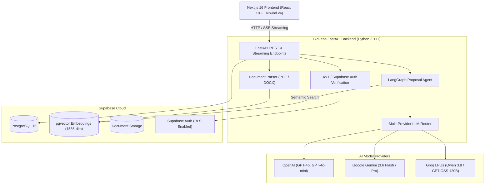

# <p align="center">🔍 BidLens</p>
<h3 align="center">AI-Powered Freelance Proposal Copilot & Job Intelligence Platform</h3>

<p align="center">
  <em>Win high-value freelance contracts in seconds with multi-agent intelligence, semantic RAG matching, and multi-model LLM generation.</em>
</p>

<p align="center">
  
  
  
  
  
  
  
</p>

---

## 🌟 Table of Contents

- [Overview](#-overview)
- [Key Features](#-key-features)
- [Architecture & Tech Stack](#-architecture--tech-stack)
- [Multi-Model AI Engine](#-multi-model-ai-engine)
- [Directory Structure](#-directory-structure)
- [Getting Started (Local Development)](#-getting-started-local-development)
  - [Prerequisites](#prerequisites)
  - [1. Backend Setup](#1-backend-setup)
  - [2. Frontend Setup](#2-frontend-setup)
  - [3. Database Setup (Supabase & pgvector)](#3-database-setup-supabase--pgvector)
- [Environment Variables](#-environment-variables)
- [API Reference](#-api-reference)
- [Deployment on Render](#-deployment-on-render)
- [Screenshots & UI Showcase](#-ui-highlights)
- [Contributing & License](#-contributing--license)

---

## 🚀 Overview

**BidLens** is an enterprise-grade AI copilot built specifically for elite freelancers, agencies, and consultants pitching on platforms like **Upwork, Fiverr, Freelancer.com, and LinkedIn**. 

Unlike generic ChatGPT templates that sound robotic and get ignored by clients, BidLens uses:
1. **Semantic RAG (pgvector embeddings)** to automatically pull in your real portfolio case studies, verified statistics, and past winning proposals.
2. **LangGraph Agent Workflow** to analyze job requirements, score client reliability, detect red flags, extract technical keywords, and craft compelling, client-centric proposals.
3. **Multi-Provider AI Router** enabling zero-latency switching between **OpenAI GPT-4o**, **Google Gemini 3.6**, and **Groq LPUs**.

---

## ✨ Key Features

### 🎯 1. Job Intelligence & Match Scoring
- **Deep Requirement Extraction**: Breaks down client listings into core deliverables, required skills, implicit expectations, and budget sanity.
- **Match Probability Engine**: Analyzes your profile vs. job posting to calculate an overall fit score and win likelihood (0-100%).
- **Client Red Flag Detection**: Identifies vague scopes, suspicious payment histories, or unrealistic budget-to-work ratios.

### 🧠 2. Agentic LangGraph Proposal Engine
- **3-Tone Generator**:
  - ⚖️ **Balanced**: Professional, value-driven, and persuasive.
  - 🔬 **Technical**: Deep-dive into architecture, tech stacks, and implementation milestones.
  - 💬 **Conversational**: High-touch, friendly, and relationship-oriented.
- **Dynamic Hooks & CTAs**: Automatically writes magnetic first sentences that stop clients from scrolling past your proposal.
- **Live Streamed Generation**: Fast, real-time token streaming with instant copy and export options (Markdown, Plain Text).

### 📂 3. Semantic Knowledge Base (RAG)
- Ingest **PDFs, DOCX, Resumes, Portfolios, and Past Proposals**.
- High-precision text chunking (`PyPDF2`, `python-docx`) with `1536-dimensional` pgvector embeddings.
- Automatic context injection during generation ensuring 100% factual accuracy with zero hallucinations.

### 👤 4. Multi-Persona Profiles & Portfolio Vault
- Create specialized profiles (e.g. *Full-Stack Engineer*, *AI / ML Consultant*, *Mobile App Developer*).
- Configure tone preferences, target word counts, and custom AI prompt instructions per persona.

### 📊 5. Proposal Pipeline & Revenue Analytics
- Track proposals across the lifecycle: `Draft` ➔ `Sent` ➔ `Shortlisted` ➔ `Won` ➔ `Lost`.
- Monitor conversion rates, total revenue won, and ROI by platform.

### 🛡️ 6. Super Admin & Governance Dashboard
- Comprehensive user management, tier assignment (`Free`, `Pro`, `Agency`), token usage monitoring, and cost tracking.
- System-wide LLM fallback controls and live API health telemetry.

### 🎨 7. Modern UI / UX Design System
- Built with **Tailwind CSS v4**, modern glassmorphism, responsive drawer navigation, dark/light themes, and 5 customizable **Accent Palettes** (Emerald, Violet, Cyberpunk, Amber, Ocean).

---

## 🏗️ Architecture & Tech Stack



### Stack Breakdown

| Layer | Technology | Purpose |
| :--- | :--- | :--- |
| **Frontend Framework** | **Next.js 16 (App Router)** | High-performance React 19 Server Components & SSR |
| **Styling & UI** | **Tailwind CSS v4, Lucide Icons, Shadcn UI** | Sleek, customizable dark/light responsive interface |
| **State & Notifications** | **React Hooks, Sonner** | Interactive state management and toast alerts |
| **Backend API** | **FastAPI (Python 3.11+)** | High-throughput async REST API with automatic OpenAPI docs |
| **Agent Orchestration**| **LangGraph & LangChain 0.3** | Cyclic multi-step agent graphs for prompt synthesis |
| **Database & Vector** | **Supabase (PostgreSQL + pgvector)** | Multi-tenant relational storage and cosine similarity search |
| **Authentication** | **Supabase Auth / JWT** | Secure Row Level Security (RLS) and role-based access |
| **Doc Processing** | **PyPDF2, python-docx, tiktoken** | PDF/DOCX document parsing & token-aware chunking |

---

## ⚡ Multi-Model AI Engine

BidLens features a unified dynamic LLM router that lets you switch between models on the fly:

| Model ID | Provider | Ideal Use Case | Speed / Benchmark |
| :--- | :--- | :--- | :--- |
| `gpt-4o` | **OpenAI** | Complex technical requirements, deep architecture synthesis | ⭐ High Precision |
| `gpt-4o-mini` | **OpenAI** | High-volume bidding, budget-conscious proposals | ⚡ Fast & Efficient |
| `gemini-3.6-flash` | **Google** | Instant multi-lingual generation, large context windows | 🚀 Ultra-fast (<1s) |
| `gemini-3.6-pro` | **Google** | Advanced problem analysis and structured RFP breakdown | 🧠 Deep Reasoning |
| `qwen/qwen3.8-27b` | **Groq** | Open-source enterprise model running on ultra-fast LPUs | ⚡ High Throughput |
| `openai/gpt-oss-120b`| **Groq** | High parameter open-weights model with near-instant inference | 🌐 Open Source |

---

## 📁 Directory Structure

```text
BidLens/
├── backend/                        # FastAPI Backend Application
│   ├── app/
│   │   ├── agent/                  # LangGraph Multi-Step Proposal Agent
│   │   │   ├── graph.py            # StateGraph compilation & edge routing
│   │   │   ├── nodes.py            # Analysis, RAG search & generator nodes
│   │   │   ├── prompts.py          # System prompts & few-shot examples
│   │   │   └── state.py            # Typed agent state definitions
│   │   ├── api/                    # API Endpoints (v1)
│   │   │   ├── endpoints/          # Jobs, Proposals, Knowledge, Profiles, Admin, Billing
│   │   │   └── router.py           # Master API v1 router
│   │   ├── core/                   # Core Settings, DB Client, Security & LLM Router
│   │   ├── schemas/                # Pydantic v2 Request & Response models
│   │   ├── services/               # Document ingestion & vector indexing
│   │   └── main.py                 # FastAPI application factory & CORS setup
│   ├── supabase/                   # Supabase Database Migrations & Schemas
│   │   └── schema.sql              # PostgreSQL tables, pgvector index & RLS policies
│   ├── requirements.txt            # Python dependencies
│   └── .env.example                # Backend environment template
│
├── frontend/                       # Next.js 16 Frontend Application
│   ├── public/                     # Static assets, branding, and logos
│   ├── src/
│   │   ├── app/                    # Next.js App Router
│   │   │   ├── (auth)/             # Login, Sign Up, Admin Login
│   │   │   ├── (dashboard)/        # Main App Dashboard
│   │   │   │   ├── dashboard/      # Overview metrics & quick generator
│   │   │   │   ├── jobs/           # Job analyzer, match scorer & proposal builder
│   │   │   │   ├── knowledge-base/ # Document upload & RAG indexer
│   │   │   │   ├── profiles/       # Persona manager & portfolio links
│   │   │   │   ├── billing/        # Plans, credit upgrades & usage
│   │   │   │   ├── admin/          # Admin governance & user analytics
│   │   │   │   └── settings/       # API keys & visual theme picker
│   │   │   ├── onboarding/         # New user onboarding wizard
│   │   │   ├── layout.tsx          # Root layout with theme & auth providers
│   │   │   └── page.tsx            # High-conversion Landing Page
│   │   ├── components/             # Reusable UI components & Layouts
│   │   ├── hooks/                  # Custom React hooks
│   │   └── lib/                    # API client, types & Supabase helpers
│   ├── package.json                # Node.js dependencies
│   ├── tsconfig.json               # TypeScript configuration
│   └── .env.local                  # Frontend environment variables
└── README.md                       # Master Documentation
```

---

## 🛠️ Getting Started (Local Development)

### Prerequisites
- **Node.js**: v20.x or v22.x
- **Python**: v3.11 or v3.12
- **Supabase Account**: (Free tier at [supabase.com](https://supabase.com))
- **OpenAI / Groq / Gemini API Key**

---

### 1. Backend Setup

1. Open a terminal and navigate to the backend directory:
   ```bash
   cd backend
   ```
2. Create and activate a Python virtual environment:
   ```bash
   # macOS / Linux
   python3 -m venv venv
   source venv/bin/activate

   # Windows
   python -m venv venv
   venv\Scripts\activate
   ```
3. Install dependencies:
   ```bash
   pip install -r requirements.txt
   ```
4. Configure your `.env` file:
   ```bash
   cp .env.example .env
   ```
   Fill in your `SUPABASE_URL`, `SUPABASE_SERVICE_ROLE_KEY`, and `OPENAI_API_KEY`.
5. Start the development server:
   ```bash
   uvicorn app.main:app --reload --port 8000
   ```
   *The backend API will be available at `http://localhost:8000` (Interactive docs at `http://localhost:8000/docs`).*

---

### 2. Frontend Setup

1. Open a new terminal and navigate to the frontend directory:
   ```bash
   cd frontend
   ```
2. Install Node dependencies:
   ```bash
   npm install
   ```
3. Configure your `.env.local` file:
   ```env
   NEXT_PUBLIC_SUPABASE_URL=https://your-project.supabase.co
   NEXT_PUBLIC_SUPABASE_PUBLISHABLE_KEY=your-supabase-anon-key
   NEXT_PUBLIC_API_URL=http://localhost:8000/api/v1
   ```
4. Start the Next.js development server:
   ```bash
   npm run dev
   ```
   *The frontend will be available at `http://localhost:3000`.*

---

### 3. Database Setup (Supabase & pgvector)

1. Create a new project on [Supabase Dashboard](https://database.new).
2. Go to **SQL Editor** in your Supabase dashboard.
3. Open `backend/supabase/schema.sql`, copy all contents, paste into the SQL Editor, and click **Run**.
4. This script automatically:
   - Enables the `pgvector` extension.
   - Creates the `app_users`, `profiles`, `knowledge_documents`, `document_chunks`, `job_analyses`, and `proposals` tables.
   - Configures vector cosine similarity indexing (`HNSW / IVFFLAT`).
   - Seeds the default admin account (`dev@sakarsa.com`).

---

## 🔐 Environment Variables

### Backend (`backend/.env`)

| Variable | Description | Required? | Default |
| :--- | :--- | :---: | :--- |
| `APP_ENV` | Application environment (`development` / `production`) | No | `development` |
| `DEBUG` | Enable Swagger `/docs` and debug logs | No | `True` |
| `CORS_ORIGINS` | Comma-separated allowed frontend origins | Yes | `http://localhost:3000` |
| `SUPABASE_URL` | Your Supabase project URL | Yes | — |
| `SUPABASE_ANON_KEY` | Supabase Anon Public Key | Yes | — |
| `SUPABASE_SERVICE_ROLE_KEY` | Supabase Service Role Key (for admin tasks) | Yes | — |
| `OPENAI_API_KEY` | OpenAI API Key (for GPT-4o & Embeddings) | Yes | — |
| `GROQ_API_KEY` | Groq API Key (for Qwen & LLaMA models) | Optional | — |
| `GOOGLE_API_KEY` | Google Gemini API Key | Optional | — |
| `LANGCHAIN_TRACING_V2` | Enable LangSmith telemetry & tracing | Optional | `False` |
| `LANGCHAIN_API_KEY` | LangSmith API Key | Optional | — |

### Frontend (`frontend/.env.local`)

| Variable | Description | Required? |
| :--- | :--- | :---: |
| `NEXT_PUBLIC_API_URL` | Full URL to the Backend API (e.g. `http://localhost:8000/api/v1`) | Yes |
| `NEXT_PUBLIC_SUPABASE_URL` | Supabase Project URL | Yes |
| `NEXT_PUBLIC_SUPABASE_PUBLISHABLE_KEY` | Supabase Anon / Publishable Key | Yes |

---

## 📡 API Reference

| Method | Endpoint | Description |
| :--- | :--- | :--- |
| `GET` | `/health` | API Health Check and service status |
| `POST` | `/api/v1/jobs/analyze` | Analyze job posting, detect skills & compute match score |
| `POST` | `/api/v1/proposals/generate` | Generate customized proposal using LangGraph agent |
| `POST` | `/api/v1/knowledge/upload` | Upload PDF/DOCX and generate 1536-dim vector embeddings |
| `GET` | `/api/v1/knowledge/documents`| List all indexed knowledge base documents |
| `GET` | `/api/v1/profiles` | Get user freelancer personas |
| `POST` | `/api/v1/profiles` | Create or update a freelancer persona |
| `GET` | `/api/v1/admin/stats` | Super Admin platform usage metrics and token totals |
| `GET` | `/api/v1/admin/users` | Manage registered users and allocate plan credits |

---

## 🚀 Deployment on Render

### Deploying the Backend
1. Create a **New Web Service** connected to your repository.
2. Set **Root Directory**: `backend`
3. Set **Runtime**: `Python 3`
4. Set **Build Command**: `pip install -r requirements.txt`
5. Set **Start Command**: `uvicorn app.main:app --host 0.0.0.0 --port $PORT`
6. Add the environment variables from the [Backend Environment Variables](#backend-backendenv) section.

### Deploying the Frontend
1. Create a **New Web Service** connected to your repository.
2. Set **Root Directory**: `frontend`
3. Set **Runtime**: `Node`
4. Set **Build Command**: `npm install && npm run build`
5. Set **Start Command**: `npm start`
6. Set `NEXT_PUBLIC_API_URL` to your live Backend Render URL (e.g., `https://bidlens-backend.onrender.com/api/v1`).
7. Update `CORS_ORIGINS` on the backend service to allow requests from your frontend Render URL.

---

## 🎨 UI Highlights

- ⚡ **Interactive Proposal Simulator**: Test out job postings with one-click tone switching directly on the landing page.
- 🌓 **Dynamic Theme System**: Seamless toggle between Dark and Light mode with persistent user preferences.
- 🌈 **5 Custom Accent Palettes**:
  - 🟢 **Emerald**: High-trust, executive feel.
  - 🟣 **Violet**: Modern AI & creative aesthetic.
  - 🔵 **Cyberpunk / Blue**: High-tech developer theme.
  - 🟠 **Amber**: High-energy agency mode.
  - 🌊 **Ocean**: Clean, focused interface.
- 📱 **100% Responsive Layout**: Fully optimized for Mobile, Tablet, and Ultra-wide Desktop displays.

---

## 🤝 Contributing & License

Contributions are always welcome! Feel free to open an Issue or submit a Pull Request.

Distributed under the **MIT License**. See `LICENSE` for more information.

<p align="center">
  Built with ❤️ for ambitious freelancers worldwide.
</p>
